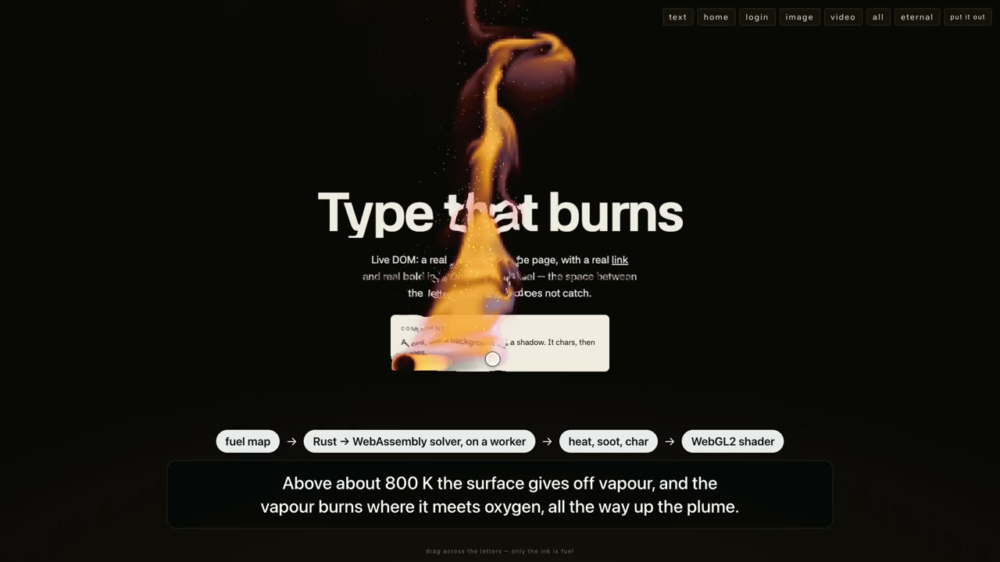
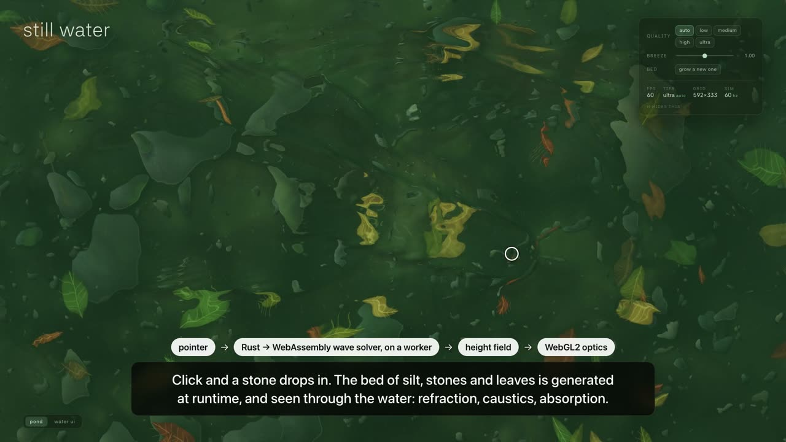
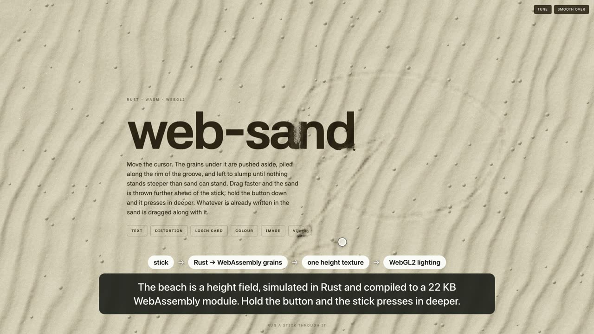
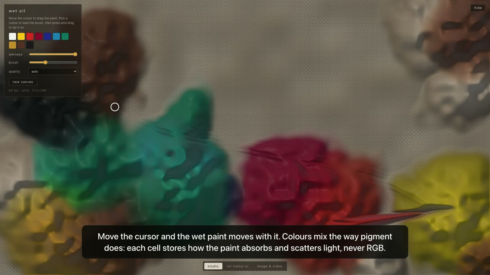
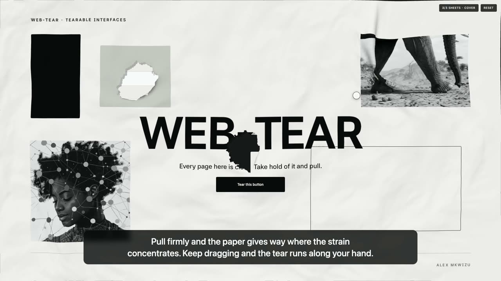
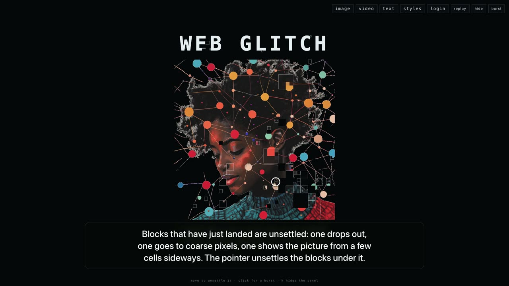

# JS Web Effects

Physical effects that run on what a web page actually contains: text, forms,
images and playing video. Each one is a solver written in Rust, compiled to
WebAssembly, and drawn with WebGL2. Each is its own npm package, with Vue 3
components and, where it makes sense, a plain-JavaScript engine.

**[Live demos and videos: genie360s.github.io/js-web-effects](https://genie360s.github.io/js-web-effects/)**

| | |
| --- | --- |
| [](https://genie360s.github.io/js-web-effects/#web-fire) | **[web-fire](packages/web-fire#readme)**<br>Combustion coupled to a buoyant incompressible airflow, in Rust and WebAssembly, burning real web content: text, components, images and video.<br><br>`npm install web-fire`<br><br>[Live demo](https://genie360s.github.io/js-web-effects/web-fire/) · [Video](https://genie360s.github.io/js-web-effects/#web-fire) · [npm](https://www.npmjs.com/package/web-fire) |
| [](https://genie360s.github.io/js-web-effects/#web-water) | **[web-water](packages/web-water#readme)**<br>An interactive pond: a Rust/WebAssembly wave solver on a worker thread, rendered over a procedurally generated bed of leaves and rocks.<br><br>`npm install web-water`<br><br>[Live demo](https://genie360s.github.io/js-web-effects/web-water/) · [Video](https://genie360s.github.io/js-web-effects/#web-water) · [npm](https://www.npmjs.com/package/web-water) |
| [](https://genie360s.github.io/js-web-effects/#web-sand) | **[web-sand](packages/web-sand#readme)**<br>Beach sand for the web: a stick dragged through a wasm grain simulation, distorting text, components, images and video as it goes.<br><br>`npm install web-sand`<br><br>[Live demo](https://genie360s.github.io/js-web-effects/web-sand/) · [Video](https://genie360s.github.io/js-web-effects/#web-sand) · [npm](https://www.npmjs.com/package/web-sand) |
| [](https://genie360s.github.io/js-web-effects/#web-oil-colours) | **[web-oil-colours](packages/web-oil-colours#readme)**<br>Wet oil paint in the browser: a Rust/WebAssembly Kubelka-Munk pigment solver on a worker thread, smeared and mixed by the cursor.<br><br>`npm install web-oil-colours`<br><br>[Live demo](https://genie360s.github.io/js-web-effects/web-oil-colours/) · [Video](https://genie360s.github.io/js-web-effects/#web-oil-colours) · [npm](https://www.npmjs.com/package/web-oil-colours) |
| [](https://genie360s.github.io/js-web-effects/#web-tear) | **[web-tear](packages/web-tear#readme)**<br>Tearable interfaces: pages of cloth you take hold of and pull, simulated in wasm off the main thread.<br><br>`npm install web-tear`<br><br>[Live demo](https://genie360s.github.io/js-web-effects/web-tear/) · [Video](https://genie360s.github.io/js-web-effects/#web-tear) · [npm](https://www.npmjs.com/package/web-tear) |
| [](https://genie360s.github.io/js-web-effects/#box-tiles-fx) | **[box-tiles-fx](packages/box-tiles-fx#readme)**<br>Title-sequence box tiles for the web: a grid of tiles that black out, shift and flare over video, images, text and live components, driven by the pointer or by the beat of the sound.<br><br>`npm install box-tiles-fx`<br><br>[Live demo](https://genie360s.github.io/js-web-effects/box-tiles-fx/) · [Video](https://genie360s.github.io/js-web-effects/#box-tiles-fx) · [npm](https://www.npmjs.com/package/box-tiles-fx) |
| [](https://genie360s.github.io/js-web-effects/#web-glitch) | **[web-glitch](packages/web-glitch#readme)**<br>A controlled glitch for the web: images, video, text and live components arrive in blocks along their own silhouette and flick between dots, mosaic, mask and characters, driven by a Rust/WebAssembly solver.<br><br>`npm install web-glitch`<br><br>[Live demo](https://genie360s.github.io/js-web-effects/web-glitch/) · [Video](https://genie360s.github.io/js-web-effects/#web-glitch) · [npm](https://www.npmjs.com/package/web-glitch) |

Click a picture for the video of how that effect works.

## Using one

```bash
npm install web-fire
```

```vue
<script setup>
import { FireSurface, FireLayer } from 'web-fire'
import 'web-fire/style.css'
</script>

<template>
  <FireSurface>
    <FireLayer><h1>Drag across this to set it alight</h1></FireLayer>
  </FireSurface>
</template>
```

Every package ships two files, `index.js` and `style.css`. The wasm core and
its worker are inside `index.js`, so there is nothing to copy into `public/`
and nothing to configure in Vite. Vue 3 is a peer dependency. Each package's README
documents its components and options, and each ships TypeScript definitions
(`index.d.ts`) for its components, engine and options.

## How the repository is arranged

```
packages/<name>/          one effect: an npm package and its demo site
  src/index.js            what the npm package exports
  src/                    components, engine, renderer, and the demo pages
  wasm/                   the Rust core (plain cdylib, no wasm-bindgen)
test_assets/              media the demos share
site/                     the landing page for GitHub Pages, and video posters
scripts/build-site.mjs    assembles the Pages site from the built demos
scripts/record-videos.mjs records the videos from the built demos
vite.lib.config.js        the library build every package shares
.github/workflows/        CI, Pages and npm publishing
```

## Working on it

Needs a current Node LTS (CI runs Node 26) and a Rust toolchain with the wasm target
(`rustup target add wasm32-unknown-unknown`).

```bash
npm install                  # once, at the root: this is an npm workspace
npm run dev -w web-fire      # one demo, with hot reload
npm run wasm                 # rebuild every Rust core
npm test                     # cargo tests, then checks against the real wasm
npm run build                # every demo site        -> packages/*/dist
npm run build:lib            # every npm library      -> packages/*/lib
npm run site                 # the GitHub Pages site  -> _site
```

The videos are recorded from the built demos by driving them in Chrome with a
scripted pointer; the storyboards are in `scripts/storyboards.mjs`. They need
Google Chrome, ffmpeg and a real GPU:

```bash
npm run build && npm run site
npm run videos                       # or: npm run videos -- web-fire
gh release upload videos videos/*.mp4 --clobber
```

The videos are kept as assets on the `videos` release rather than in git, and
the Pages workflow pulls them from there.

## Releasing

1. Bump `version` in the package's `package.json` and merge to `main`.
2. Publish a GitHub release, with any tag.

The **Publish** workflow then publishes every package whose version npm does
not have yet, and the **Pages** workflow redeploys the site. Publishing uses
[npm trusted publishing](https://docs.npmjs.com/trusted-publishers): npm trusts
`publish.yml` in this repository through OIDC, so no token is stored anywhere,
and each release carries provenance.

A new package needs two manual steps before the workflow can publish it,
because npm can only trust a package that already exists:

```bash
npm publish -w <name> --access public
npm trust github <name> --file publish.yml --repo genie360s/js-web-effects --allow-publish
```

## License

MIT. See [LICENSE](LICENSE).
